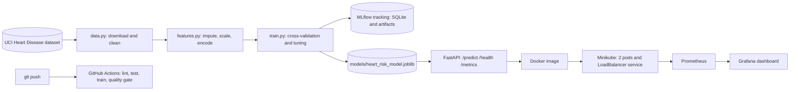

# Heart Disease Risk Prediction: End-to-End MLOps Pipeline


A reproducible machine-learning pipeline that predicts heart-disease risk from patient health data
(UCI Heart Disease dataset), served as a containerised, monitored API on Kubernetes.
Course: BITS Pilani M.Tech AI/ML, MLOps (AIMLCZG523), Assignment 01.

- **Demo video:** `<add link or file name here>`
- **Final report:** `report/MLOps_Assignment1_Report.docx` (PDF copy in the same folder)

> Educational project only. This is not a medical device.

## Architecture



## Where each requirement lives

| Task | Marks | Code and config | Evidence |
|---|---|---|---|
| 1. Data acquisition and EDA | 5 | `heart_risk/data.py`, `data/raw/`, `data/processed/`, `notebooks/01_eda.ipynb` | `report/figures/` |
| 2. Features and models | 8 | `heart_risk/features.py`, `heart_risk/train.py` | report section 5 |
| 3. Experiment tracking (MLflow) | 5 | MLflow calls in `heart_risk/train.py` | `report/experiment_summary.csv`, `screenshots/mlflow_*` |
| 4. Packaging and reproducibility | 7 | `models/`, `requirements*.txt`, `heart_risk/predict.py` | `models/model_card.json` |
| 5. CI/CD and tests | 8 | `test/`, `.github/workflows/ci.yml`, `scripts/check_model.py` | `screenshots/ci_*` |
| 6. Containerization | 5 | `Dockerfile`, `.dockerignore`, `api/` | `screenshots/docker_*` |
| 7. Deployment | 7 | `k8s/`, `scripts/deploy_local.sh` | `screenshots/k8s_*` |
| 8. Monitoring and logging | 3 | `monitoring/`, `scripts/deploy_monitoring.sh`, `scripts/send_traffic.py` | `screenshots/mon_*` |
| 9. Documentation | 2 | this README, `report/` | the report |

## Repository layout

| Path | Purpose |
|---|---|
| `heart_risk/` | Package: `data.py`, `features.py`, `train.py`, `predict.py` |
| `api/` | FastAPI service with request logging and Prometheus metrics; `sample_request.json` |
| `notebooks/` | EDA notebook |
| `test/` | Pytest unit tests (data, features, prediction, API) |
| `models/` | Saved pipeline (`joblib`) and `model_card.json` |
| `data/` | Raw and cleaned datasets |
| `k8s/` | Deployment, LoadBalancer Service, headless Service |
| `monitoring/` | Prometheus config, Grafana config and dashboard |
| `scripts/` | Setup, deployment, traffic generator, quality gate, report builder |
| `screenshots/` | Evidence for the report |
| `report/` | Figures, experiment summary, final report |

## Setup (clean machine, Python 3.11)

```bash
git clone https://github.com/BharathKumarABits/MLOPs.git && cd MLOPs
python3.11 -m venv .venv && source .venv/bin/activate
pip install -r requirements-dev.txt
```

## Run the pipeline

```bash
python -m heart_risk.data      # download from UCI, write data/raw and data/processed
python -m heart_risk.train     # 4 candidate models, MLflow tracking, saves models/
pytest -v                      # unit tests
flake8 heart_risk test scripts api
mlflow ui --backend-store-uri sqlite:///mlflow.db   # http://127.0.0.1:5000
```

## Serve locally

```bash
uvicorn api.main:app --port 8000
curl -s -X POST http://localhost:8000/predict -H "Content-Type: application/json" -d @api/sample_request.json
```
Response: `{"prediction":1,"label":"heart disease","confidence":0.98,"probability_disease":0.98}`.
Interactive docs: http://localhost:8000/docs

## Docker

```bash
docker build -t heart-risk-api:1.0 .
docker run -d --name heart-api -p 8000:8000 heart-risk-api:1.0
curl -s http://localhost:8000/health
```

## Kubernetes (Minikube) and monitoring

```bash
bash scripts/setup_vm.sh            # lab VM only: kubectl, extensions (system installs reset between sessions)
bash scripts/deploy_local.sh        # Minikube + image build + Deployment (2 replicas) + LoadBalancer Service
minikube tunnel                     # keep running in a second terminal
kubectl get svc heart-risk-api      # use the EXTERNAL-IP shown
curl -s http://<EXTERNAL-IP>:8000/health

bash scripts/deploy_monitoring.sh   # Prometheus + Grafana with a provisioned dashboard
kubectl port-forward svc/prometheus 9090:9090 &
kubectl port-forward svc/grafana 3000:3000 &
python scripts/send_traffic.py --url http://<EXTERNAL-IP>:8000 --n 300
```
Prometheus targets: http://localhost:9090/targets. Grafana dashboard: http://localhost:3000/d/heart-risk-api.

### Access instructions for the deployed API
The API is not publicly hosted; it runs in a local Minikube cluster. To reach it, run the three
Kubernetes commands above (`deploy_local.sh`, `minikube tunnel`, `kubectl get svc`), then call
`http://<EXTERNAL-IP>:8000/predict`, `/health`, `/metrics` or `/docs`.

## Results

5-fold stratified CV on the training split (80%); hold-out test split (20%, never used for tuning).

| Run | CV ROC-AUC | CV recall | Test ROC-AUC | Test recall | Test accuracy |
|---|---|---|---|---|---|
| logreg_baseline | 0.907 | 0.766 | 0.958 | 0.929 | 0.869 |
| **logreg_tuned (selected)** | **0.908** | **0.828** | 0.958 | 0.929 | 0.869 |
| rf_baseline | 0.894 | 0.783 | 0.945 | 0.964 | 0.869 |
| rf_tuned | 0.902 | 0.764 | 0.955 | 0.929 | 0.885 |

The model is selected by mean CV ROC-AUC, not by test score. The test set has about 61 patients, so
differences of one patient are noise. Full metrics are in the report.

## CI/CD

GitHub Actions (`.github/workflows/ci.yml`) runs on every push: lint (flake8), unit tests with coverage,
model training, and a quality gate (`scripts/check_model.py`: test ROC-AUC must be at least 0.80).
Any failing step fails the pipeline; the trained model and reports are uploaded as artifacts.

## Reproducibility notes

- Dependencies are pinned in `requirements*.txt` (a saved model must be loaded with the same scikit-learn version).
- Preprocessing (imputation, scaling, one-hot encoding) lives inside the saved pipeline, so training and serving cannot drift apart.
- Fixed random seeds are used throughout.
- Development used a cloud lab VM that resets between sessions; `scripts/setup_vm.sh` and `scripts/deploy_local.sh` rebuild the toolchain and deployment.
